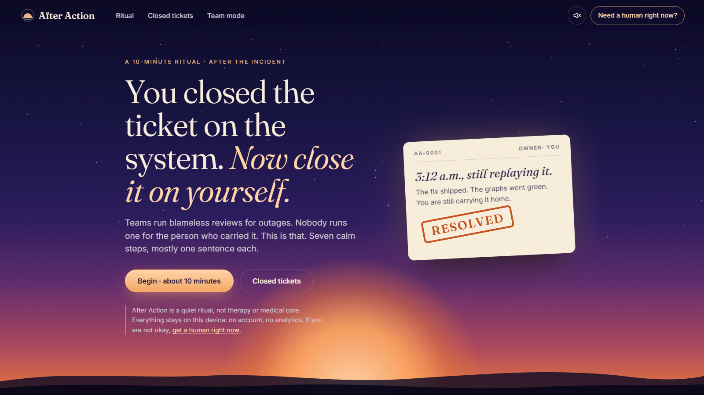
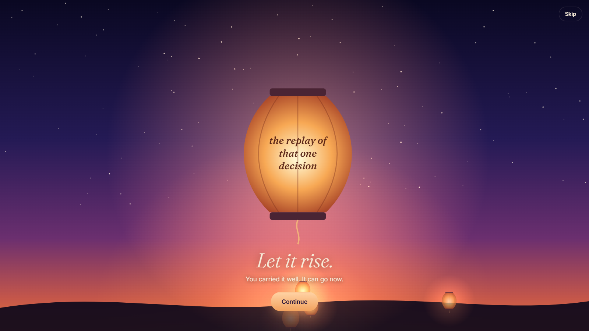

# AFTER ACTION

Teams run blameless reviews for the system. This is the one for the human: a 10-minute ritual to close the ticket on yourself.

**[Live demo](https://tootenramen.github.io/After-Action/)**

## What you can do
- Name what you just came through, then pick what you carried and set each stone down on a body outline.
- Take a 20-second guided body check, then write a blameless review of yourself in three short prompts.
- Close the ticket with a Stamp, a Lantern, or a locked Archive drawer (soft synthesized sound, off by default).
- Pick one kindness for tonight, optionally with a single browser reminder, and download your After Action card as a PNG.
- Keep a private list of closed tickets with gentle patterns, plus a Team mode debrief template you can copy as markdown.

## How it works
One static HTML file. Everything runs client-side: history lives in your browser's localStorage, cards are drawn on canvas, sounds are WebAudio. No accounts, no analytics, no network calls beyond a font. Free-text fields are checked by a small crisis-language matcher that points to a Help panel (988 in the US, findahelpline.com, local emergency number, a doctor or EAP). After Action is not therapy or medical care.

## Skills this shows
Product and emotional design, canvas animation, accessible interaction (drag plus keyboard), privacy-first local-only apps, safety-minded UX.

Built by Gustavo Freitas - [LinkedIn](https://www.linkedin.com/in/gustavo-freitas-69b93910b/) - [more projects](https://github.com/Tootenramen)
